<p align="center">
  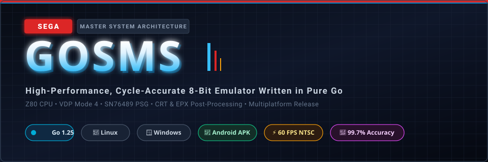
</p>

<p align="center">
  <a href="https://golang.org"></a>
  
  
  
  <a href="#licencia"></a>
</p>

---

## ⚡ Descripción

**GoSMS** es un emulador de **Sega Master System (SMS)** de alto rendimiento, ciclo-exacto y multiplataforma, desarrollado en **Go puro** con aceleración gráfica mediante [Ebitengine](https://ebitengine.org/). 

Diseñado desde cero con foco en la precisión de sincronismo NTSC (≈59.9227 FPS), emulación acústica de calidad de estudio sin deriva ni artefactos digitales, post-procesado visual en tiempo real (CRT Scanlines, Scale2x EPX, Remaster 2026 con sharpening, bloom y color grading) y generación automatizada de paquetes portables para **Linux**, **Windows** y **Android (APK nativo con lanzador, selector de ROM y HUD táctil)**.

<p align="center">
  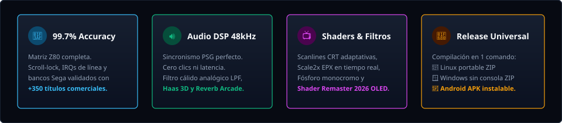
</p>

---

## 🏛️ Arquitectura del Sistema

<p align="center">
  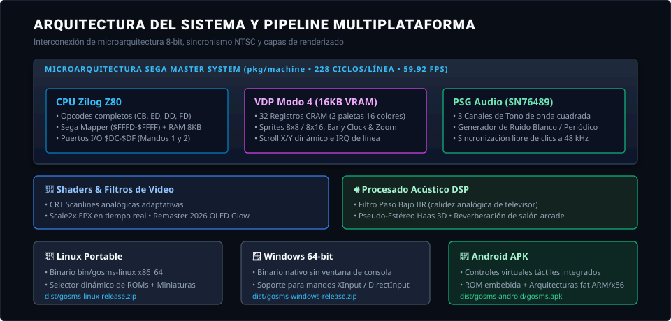
</p>

### Subsistemas Emulados

| Subsistema | Implementación y Características Técnicas |
| :--- | :--- |
| **CPU Zilog Z80** | Decodificador completo de opcodes con matrices de prefijos `CB`, `ED`, `DD` y `FD`. Manejo estricto de banderas no documentadas (X/Y, F3/F5), interrupciones enmascarables modo 1 e interrupción física no enmascarable `NMI` (botón PAUSE). |
| **VDP Modo 4** | 16 KB VRAM, 32 registros CRAM con 2 paletas de 16 colores. Sincronismo exacto a 228 ciclos por scanline × 262 líneas. Sprites 8×8 y 8×16 con zoom, bit de *early clock* (desplazamiento de 8 píxeles a la izquierda), scroll dinámico horizontal/vertical e IRQs de línea de barrido programable. |
| **Memoria & Mapper** | Gestión de bancos de cartucho Sega (`$FFFD-$FFFF`), RAM de sistema de 8 KB con espejos completos y soporte de persistencia de partidas guardadas con batería SRAM (`.sav`) y snapshots en caliente (`.state`). |
| **PSG SN76489** | 3 canales de onda cuadrada independientes y generador de ruido blanco/periódico. Sincronización libre de clics a 48.000 Hz acoplada al renderizado del VDP. |
| **Audio DSP** | Procesamiento digital de señal en tiempo real: filtro paso bajo analógico IIR (~5.5 kHz), dimensionalidad 3D pseudo-estéreo (algoritmo Haas con retardo de 9 ms) y reverberación acústica de recreativa. |
| **Shaders & Vídeo** | Pipeline multi-pase con Scale2x EPX, rejilla CRT, bloom multinivel y color grading. El pack HD sustituye tiles por arte remasterizado 4× u 8×, con un cielo moderno con degradado y halo de sol. |

---

## 🎮 Controles y Mapeo

El emulador detecta automáticamente teclados, mandos USB/Bluetooth estándar (Xbox, PlayStation, 8BitDo) y mandos táctiles en Android:

| Función | Jugador 1 (Teclado) | Jugador 2 (Teclado) | Mando USB / Bluetooth | Android Touch HUD |
| :--- | :--- | :--- | :--- | :--- |
| **Cruceta / Movimiento** | Flechas `↑` `↓` `←` `→` | `W` `A` `S` `D` | D-Pad / Stick Izquierdo | D-Pad Virtual (Izquierda) |
| **Botón 1 (Disparo / Salto)** | `Z` o `Espacio` | `Q` | `A` (Xbox) / `✕` (PlayStation) | Botón verde `( 1 )` |
| **Botón 2 (Salto / Disparo)** | `X` | `E` | `B` (Xbox) / `◯` (PlayStation) | Botón rojo `( 2 )` |
| **Botón PAUSE / START (Consola)** | `P` o `Enter` | — | Botón `Start` | Botón `[ PAUSE ]` |
| **Cambiar Filtro de Vídeo** | `F1` o `V` | — | — | — |
| **Música de fondo ON/OFF** | `F6` o `M` | — | — | — |
| **Alternar HD / Original** | `F10` | — | — | — |
| **Cambiar Filtro de Audio** | `F2` o `B` | — | — | — |
| **Guardar Partida Rápida** | `F3` | — | — | — |
| **Cargar Partida Rápida** | `F4` | — | — | — |
| **Captura de pantalla** | `F5` | — | — | — |
| **Pantalla Completa** | `F11` | — | — | — |
| **Ayuda de controles** | `F12` o `H` | — | — | Botón `CONTROLES` |
| **Volver al Menú / Salir** | `Esc` | — | — | Botón `MENÚ` / atrás |
| **Elegir / cambiar ROM** | — | — | — | `ELEGIR ROM` / `CAMBIAR ROM` |

> En Alex Kidd, **PAUSE / START** (`P` o `Enter`, o `Start` en el mando) abre el mapa e inventario del juego. `Esc` vuelve al menú del emulador.

> Los mandos USB/Bluetooth se detectan en caliente: el menú muestra el modelo conectado y, en partida, aparece un aviso al conectar o desconectar.

> El menú incluye **F12 / H → Controles** y un tutorial de primer arranque. Los ZIP de release incluyen `CONTROLES.md`.

> En el menú, el mando también navega: **D-pad/stick** elige, **A/Start** juega y **B/Back/Esc** sale. El tutorial de controles se cierra con esos mismos botones.

---

## 🚀 Compilación y Ejecución

### Requisitos Previos

- **Go 1.25** o superior (descarga automática de toolchain vía `go.mod`).
- **Docker** (únicamente necesario si deseas compilar el APK de Android en release).
- Bibliotecas nativas de desarrollo para Ebiten (OpenGL/ALSA en Linux):
  ```bash
  sudo apt-get install -y libgl1-mesa-dev xorg-dev libasound2-dev
  ```

### Comandos Rápidos

```bash
# Ejecutar emulador con la interfaz gráfica y selector interactivo
make run

# Compilar binarios de desarrollo en bin/
make build

# Ejecutar la suite de pruebas Go
make test

# Benchmarks del núcleo y FPS con una ROM real
make bench
make perf ROM="roms/juego.sms"
make bench-ui ROM="roms/juego.sms"   # HD + Remaster 2026 por defecto

# Ejecutar auditoría de compatibilidad de todas las ROMs
make audit
```

La línea base de rendimiento y los criterios para no romper los FPS durante
refactors están en [`docs/PERFORMANCE.md`](docs/PERFORMANCE.md).

### Remasterizar una ROM

El remaster es **matemático, sin IA**: vectoriza cada objeto con campos de distancia, aplica antialiasing real y deja el **albedo plano** con la paleta de cine. El emulador le añade el **cielo moderno** (degradado y halo de sol) y el postprocesado. No descarga modelos y es determinista.

En **Castle of Illusion**, además de los seis mundos, se capturan la pantalla de título y el menú `PRACTICE / NORMAL` como ventanas estáticas: son pantallas fijas y ganan mucho en HD sin ensuciar el pack con transiciones.

### Antes y después

Misma captura y mismo frame de juego, sin menús ni superposiciones. La columna derecha usa **F10** (pack HD 4×) y **F1 → Remaster 2026**.

**Alex Kidd in Miracle World**

| Original | F10 + Remaster 2026 |
|---|---|
| 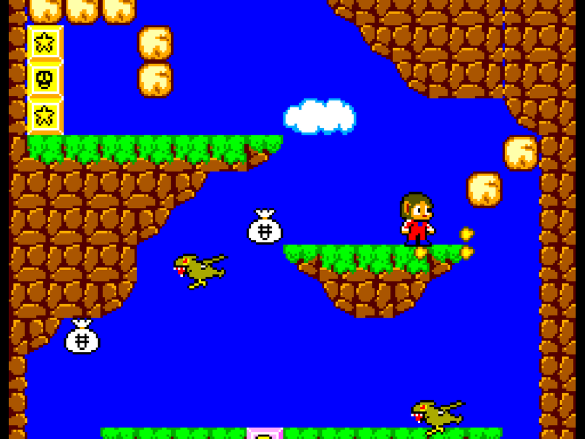 | 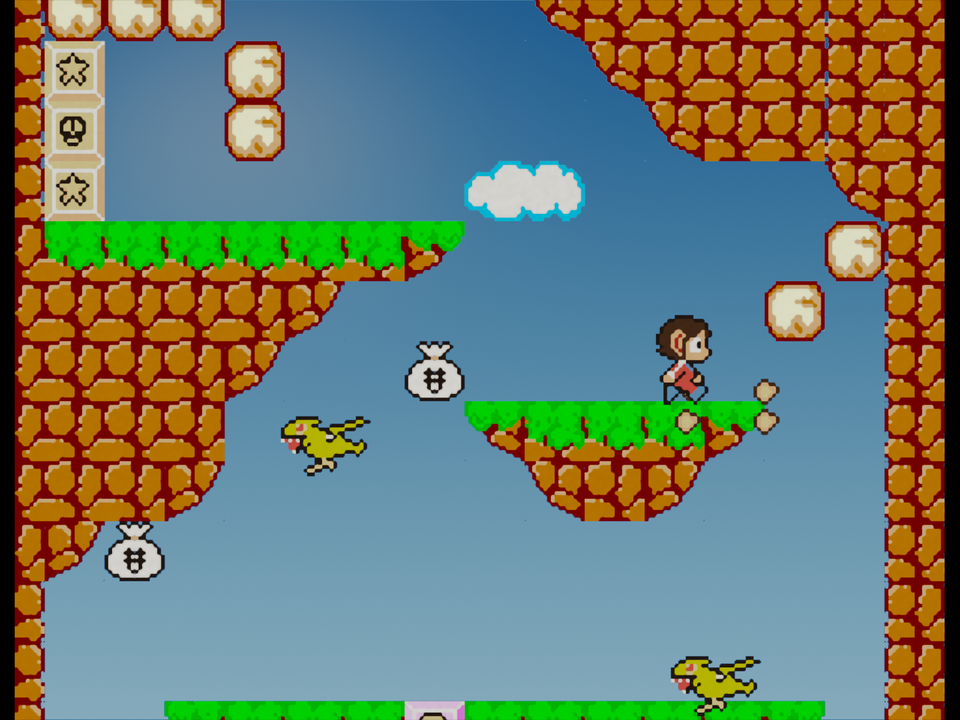 |

**Sonic The Hedgehog**

| Original | F10 + Remaster 2026 |
|---|---|
| 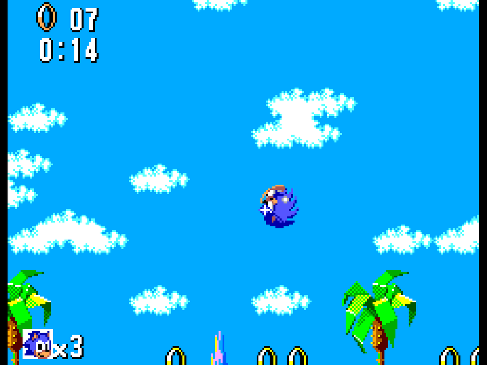 | 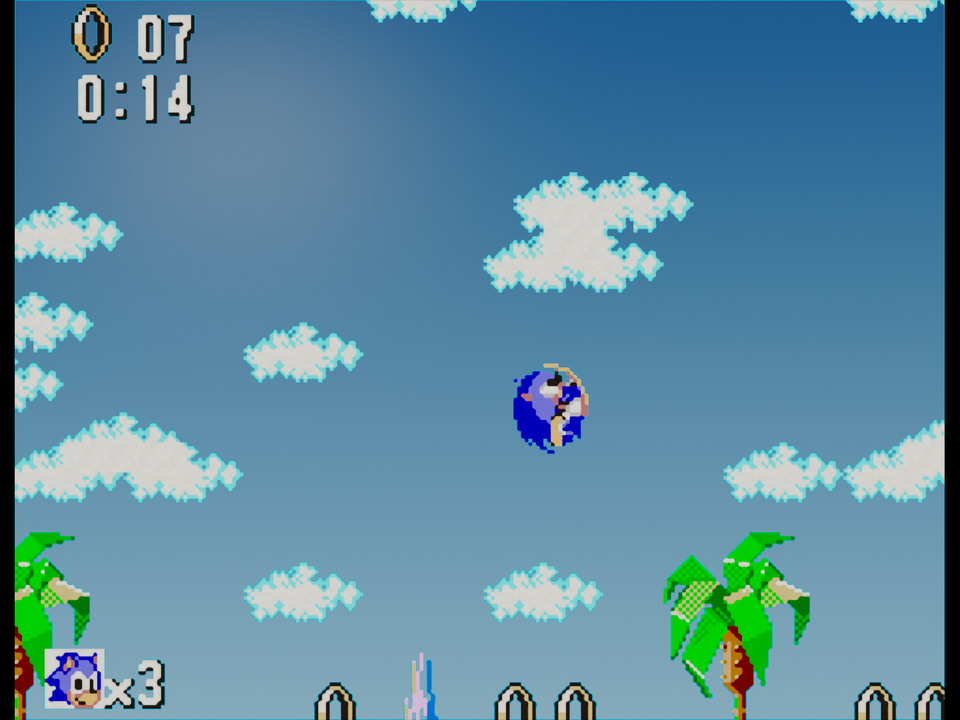 |

**Castle of Illusion**

| Original | F10 + Remaster 2026 |
|---|---|
| 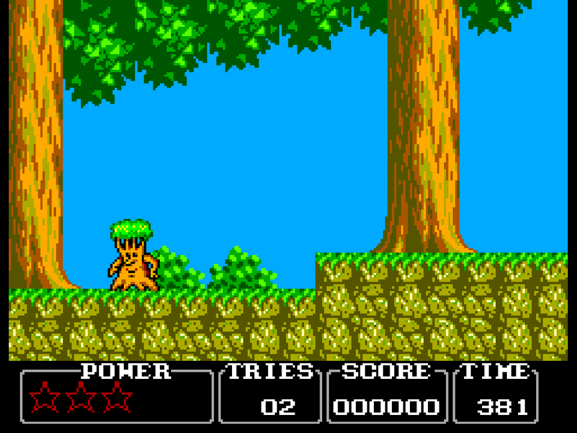 | 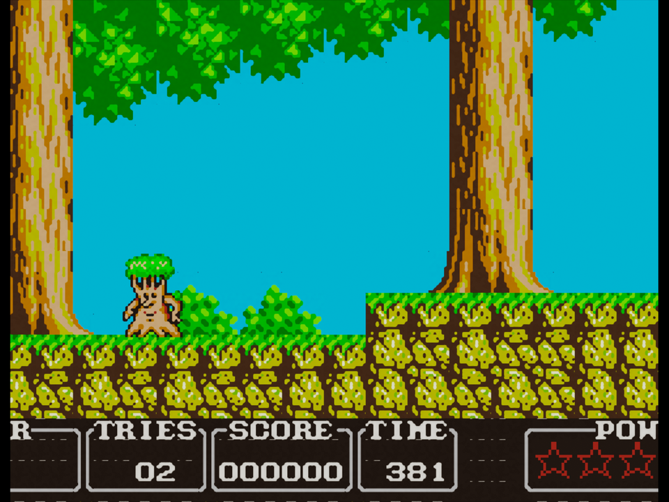 |

**Pantallas de título**

Castle of Illusion remasteriza también el título y el menú de dificultad. Son
pantallas fijas, así que se capturan aparte de los seis mundos.

| Pantalla | Original | F10 + Remaster 2026 |
|---|---|---|
| Título | 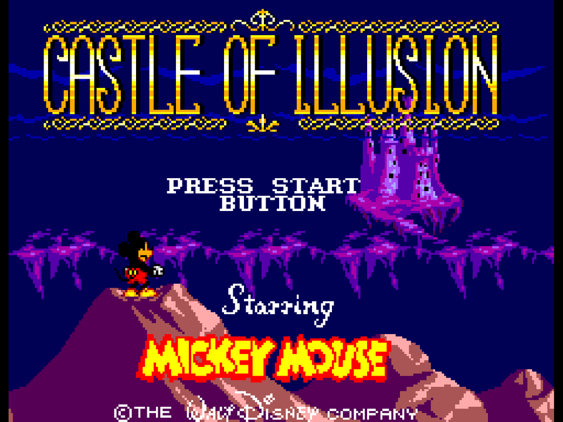 | 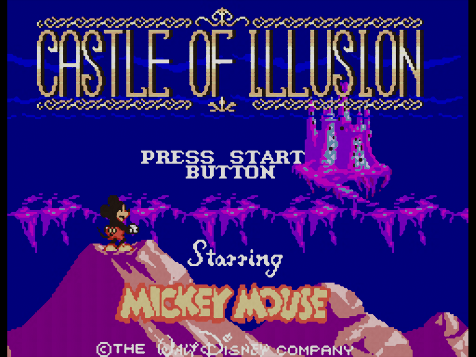 |
| Menú | 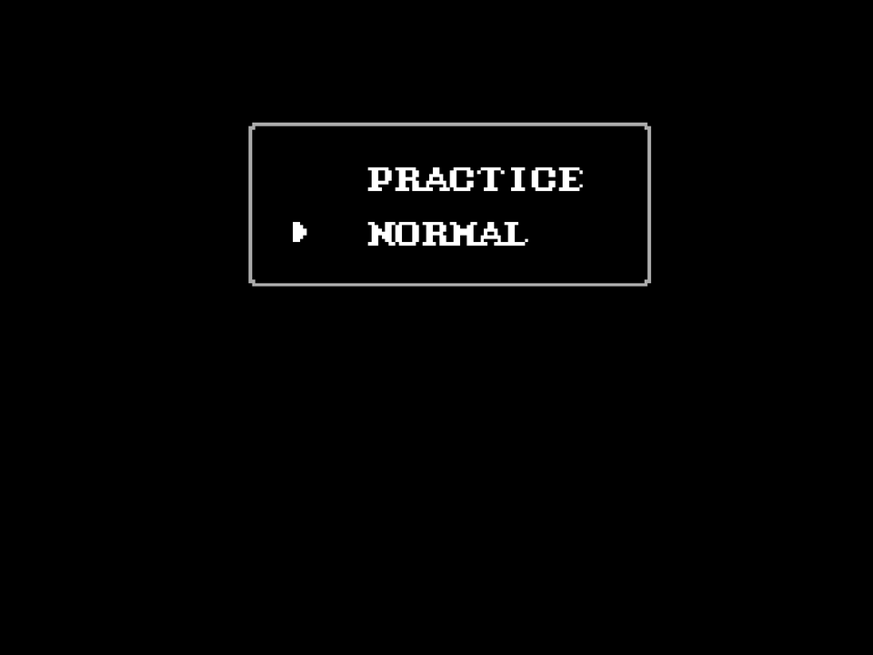 | 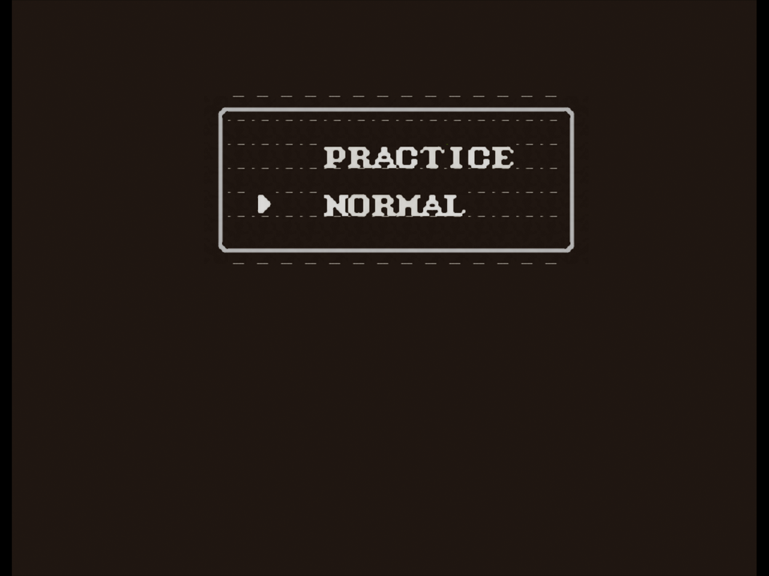 |

### Parallax 2.5

Mismo frame, con **F10** y el filtro **MODERN+ PARALLAX**: cielo procedural con nubes, sol y montañas en varias capas.

**Alex Kidd in Miracle World**

| Original | F10 + Modern+ Parallax |
|---|---|
|  | 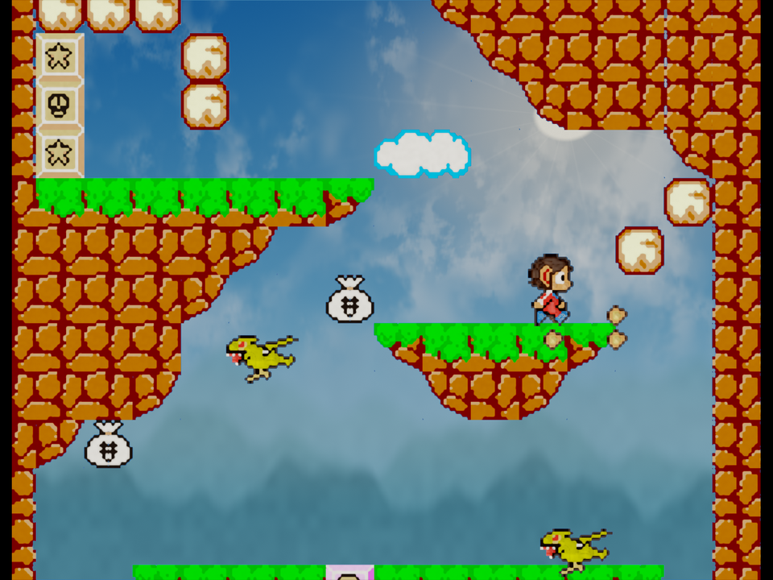 |

**Castle of Illusion**

| Original | F10 + Modern+ Parallax |
|---|---|
|  | 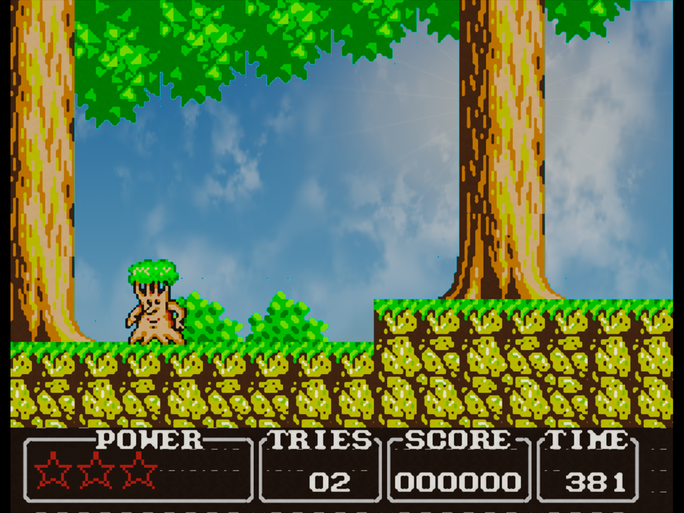 |

**Ciclo día/noche**

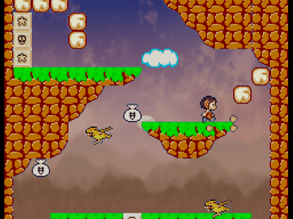

El sol y la luna recorren el cielo, las nubes cambian de color, aparecen estrellas y la escena se tiñe de noche. Dura **180 segundos** por defecto; `-day-cycle` cambia la duración (`0` lo desactiva). En `cmd/preview`, `-time` y `-cycle` permiten capturar una fase concreta.

Para Alex Kidd, un solo comando lo hace todo (borra, extrae, vectoriza y empaqueta):

```bash
make remaster ROM="roms/Alex Kidd in Miracle World (UE) (V1.1) [!].sms"
```

Para otras ROMs, el perfil de controles de Alex Kidd no sirve; usa `BOT=default` (corre a la derecha y salta). Para los juegos con recorrido completo por niveles:

```bash
# Sonic 1: los 18 actos con el selector de nivel por RAM
make remaster ROM="roms/Sonic The Hedgehog (USA, Europe).sms" BOT=default SONIC_ALL=1

# Castle of Illusion: los 6 mundos entrando por las puertas del castillo
make remaster ROM="roms/Castle of Illusion Starring Mickey Mouse (U) (V1.1) [!].sms" BOT=default CASTLE_ALL=1
```

Sin esos modificadores, la extracción solo captura las escenas por las que pasa el bot (`FRAMES`, 6500 por defecto). Para más zonas, sube `FRAMES` o usa level select/save states antes del volcado.

Necesita Python 3 con `numpy` y `Pillow`. `make setup` crea `.venv-remaster/` con ambas.

Por defecto se genera un pack 4× (cada tile de 8×8 pasa a 32×32). Para 1440p o 4K puedes generar el pack 8×:

```bash
make remaster ROM="roms/Alex Kidd in Miracle World (UE) (V1.1) [!].sms" PACK_SCALE=8
```

El pack 8× se divide automáticamente en páginas de color (`pack.json` + `pages/`), con carga perezosa.

Puedes ajustar el acabado sin volver a extraer:

```bash
make cinematic ROM="..." CINE_NOISE=0.03
make pack ROM="..."
make run ROM="..."
```

El acabado de cine (pelo castaño, piel tostada, blanco hueso y carmesí) ya es el que aplica `make remaster`. La paleta está en `tools/grades.py`: cambia un color allí, vuelve a lanzar `make cinematic` y `make pack`, y el emulador graduará también el fondo y los tiles sin remasterizar con `hd/palette.json`.

El pack lleva el albedo y la paleta. El filtro **REMASTER 2026** añade bloom y tone mapping, sustituye el azul plano del cielo por un degradado con halo de sol y **F10** compara con el original. **MODERN+** sube bloom, saturación y contraste; **MODERN+ PARALLAX** añade el cielo procedural con nubes y montañas. Para comparar sin el cielo, `cmd/preview` acepta `-nosky`. En equipos modestos, **SUAVIZADO** es el modo ligero: desactiva cielo y bloom.

El estilo del propio pack se elige con `PACK_STYLE`:

```bash
make cinematic ROM="..." PACK_STYLE=modern-plus
make pack ROM="..."
```

Si generas varios estilos, `make select-hd ROM="..." HD_STYLE=modern-plus` activa uno sin volver a vectorizar.

#### Estilos de pack

- **`cinematic`**: albedo plano y fiel al original. Es el estilo por defecto.
- **`modern-plus`**: sprites y objetos aislados con oclusión ambiental, materiales, rim light y grading moderado.

Los **fondos se mantienen planos a propósito**: iluminar cada bloque por separado crea costuras visibles en el mosaico. El volumen moderno se reserva a sprites y objetos aislados, y los filtros **MODERN+ / MODERN+ PARALLAX** añaden el grading y el cielo procedural encima del pack.

> **F1** recorre los 8 filtros de vídeo: Píxel Perfect, CRT, EPX, Suavizado, Fósforo, Remaster 2026, Modern+ y Modern+ Parallax.

### Música de fondo opcional

Si colocas un tema propio en `assets/<ROM>/music/theme.ogg` (Ogg **Vorbis**, no Opus), **no suena al arrancar**: pulsa **F6** o **M** para activarlo (o arranca con `-music`). Mientras suena, silencia los canales de tono del PSG para no duplicar la música original; los efectos de ruido siguen sonando. Con `-music-mix` se mezclan ambos. Si el OGG es Opus u otro formato, se convierte automáticamente a Vorbis con `ffmpeg` y se cachea como `theme-vorbis.ogg`.

`make objects` y `make remaster` conservan `music/`, validan el formato y lo convierten a Vorbis si hace falta con `ffmpeg`.

### Bloques de fondo

La extracción agrupa bloques de fondo de 8×8 tiles para vectorizar escenarios completos en vez de tiles aislados. Usa `BG_GROUP=0` para desactivarlos o `BG_PROTECT=3` para proteger más filas del HUD.

`make pack` informa de la cobertura por fuente (composites, fallback por tile, overrides manuales) y deja el detalle de los tiles compartidos en `hd/conflicts.json`.

Los detalles del algoritmo, los parámetros y las carpetas de trabajo están en la [Guía de remasterización HD](docs/GUIA_REMASTER_HD.md).

---

## 📦 Generación de Releases Multiplataforma

El proyecto cuenta con un sistema de release totalmente automatizado en **un único comando**:

```bash
make release
```

Este comando compila de forma paralela y genera en el directorio `dist/`:

1. **🐧 Linux**: Paquete portable `dist/gosms-linux-release.zip` listo para descomprimir y jugar.
2. **🪟 Windows**: Paquete portable `dist/gosms-windows-release.zip` con ejecutable GUI optimizado (sin consola CMD emergente).
3. **📱 Android**: Archivo `dist/gosms-android/gosms.apk` compilado dentro de un contenedor Docker aislado mediante `ebitenmobile` y empaquetado nativamente con el SDK de Android (`aapt2`, `d8`, `zipalign` y `apksigner`).

### Android

La APK arranca en un **lanzador con la estética del escritorio**. Como Android no permite leer una carpeta `roms/`, el botón **ELEGIR ROM** abre el selector de archivos del sistema y carga un `.sms`:

- **JUGAR** inicia la ROM recordada.
- **CAMBIAR ROM** vuelve a abrir el selector.
- **MENÚ** (en el HUD) o el botón **atrás** vuelven al lanzador; desde el lanzador, atrás sale de la app.
- La última ROM se recuerda entre arranques (permiso persistente del selector).
- El HUD táctil es responsive: D-pad, botones 1/2, PAUSA y MENÚ, con la misma paleta azul/neón del escritorio.
- El botón **CONTROLES** del lanzador abre la ayuda táctil.

El selector usa `ACTION_OPEN_DOCUMENT`, así que no hace falta permiso de almacenamiento.

El APK renderiza la ROM a resolución nativa. El pack HD es **por ROM** y se genera en el escritorio (`make remaster`), así que no se incluye para ROMs arbitrarias; la interfaz, el lanzador y el HUD sí son los mismos.

---

## 🛠️ Herramientas de Desarrollo y Diagnóstico

El repositorio incluye herramientas CLI dedicadas para análisis técnico:

- **`cmd/headless`**: Ejecuta la emulación sin interfaz gráfica para pruebas de regresión, volcados de memoria y capturas automáticas:
  ```bash
  # Ejecutar 400 frames pulsando START en el frame 120 y guardar captura PNG
  go run ./cmd/headless -frames 400 -start 120 -out captura.png ruta/juego.sms

  # Volcar audio WAV y name table para análisis de VRAM
  go run ./cmd/headless -frames 600 -wav salida.wav -nt ruta/juego.sms
  ```
- **`cmd/tracer`**: Trazador de ciclo a ciclo de instrucciones Z80 con seguimiento de registros y flags:
  ```bash
  go run ./cmd/tracer -n 5000 ruta/juego.sms
  ```
- **`cmd/preview`**: Renderiza un único frame a PNG con el mismo pipeline de postprocesado y el pack HD. Sirve para comparar filtros sin abrir el emulador:
  ```bash
  go run ./cmd/preview -frames 900 -filter modern -hd -out preview.png roms/juego.sms
  ```

---

## 👤 Autor

Desarrollado con pasión por **Enrique González Gutiérrez**.

Copyright © 2026 Enrique González Gutiérrez.

---

## 📄 Licencia

GoSMS se distribuye bajo la **GNU Affero General Public License v3.0 o posterior**
(AGPL-3.0-or-later). Consulta [`LICENSE`](LICENSE) para el texto completo y
[`LICENSING.md`](LICENSING.md) para los detalles.

Si necesitas integrar GoSMS en un producto propietario o utilizarlo sin las
obligaciones de AGPL, hay una **licencia comercial** disponible a través del
repositorio: https://github.com/enriquegonzalezgutierrez/gosms.

La licencia cubre el código del emulador. Las ROMs, los packs gráficos derivados
y otros materiales de terceros no se distribuyen con el repositorio y siguen
perteneciendo a sus titulares.

Para pruebas de autoría, registro y vigilancia, consulta
[`docs/PROPIEDAD_INTELECTUAL.md`](docs/PROPIEDAD_INTELECTUAL.md).

---

## ⚖️ Aviso legal

GoSMS **no incluye ROMs, BIOS ni assets gráficos o sonoros de juegos**. Para
usarlo necesitas tus propias ROMs, obtenidas legalmente.

Sega, Sega Master System, Sonic The Hedgehog, Alex Kidd, Castle of Illusion,
Mickey Mouse y el resto de nombres y personajes mencionados son marcas o
propiedades de sus respectivos titulares. GoSMS no está afiliado, patrocinado
ni respaldado por Sega, Disney ni ninguna otra compañía.

Las capturas de comparación del README se incluyen únicamente para ilustrar el
efecto del remaster sobre juegos que el usuario puede ejecutar con sus propias
ROMs. Pertenecen a sus titulares y se retirarán si sus propietarios lo solicitan.

Los packs HD generados a partir de una ROM son obras derivadas de su arte
original: no se distribuyen con el repositorio y no deben publicarse.
